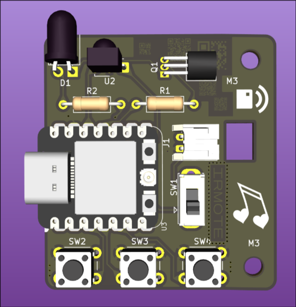
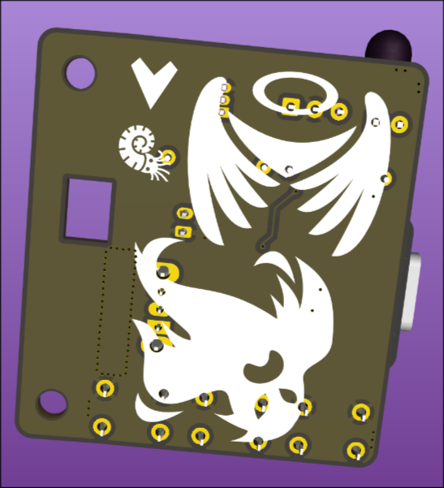
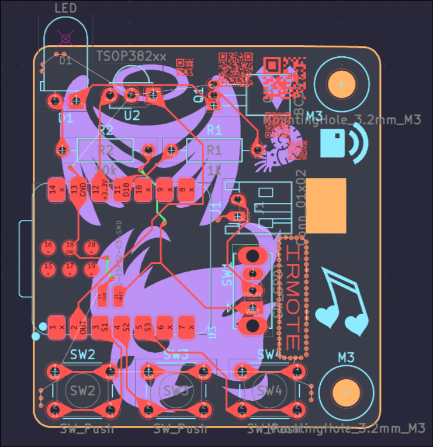
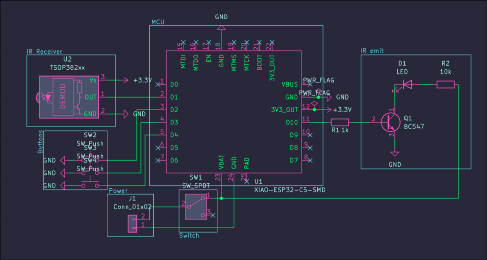
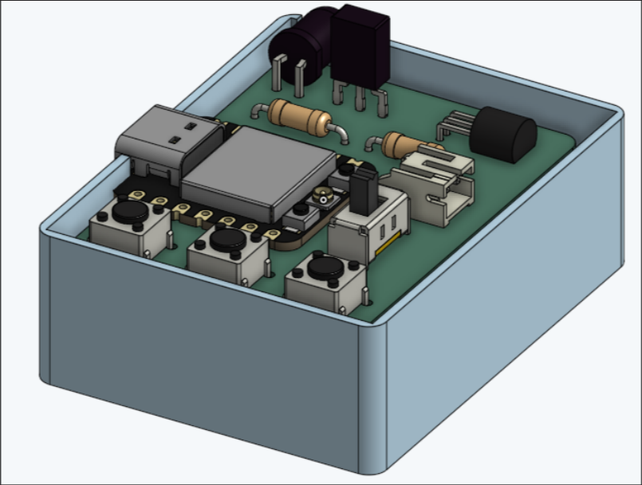

# IRMote
A small IR remote built using a XIAO ESP32 C3. Point a remote at it, press a button, and it remembers the signal. Press another button and it re emit it back out.

## Gallery
## Final PCB front

## Final PCB back

### PCB

### Schematics

### Case

https://cad.onshape.com/documents/72053f8b7099b1ee551be8fa/w/c9c509dfd2f6c74695d77e8d/e/00c4d274837c6173d7a47207?renderMode=0&uiState=6ad7b619d79b6117422c9eec

## Buttons
| Button | What it does                     |
| ------ | -------------------------------- |
| Left   | Capture an IR signal             |
| Middle | Reset (forget the stored signal) |
| Right  | Re-emit the stored signal        |

## Hardware
- Seeed XIAO ESP32 C3
- TSOP38238 IR receiver
- IR LED driven by a BC547
- 3 push buttons
- Slide switch
## Building it
1. Install the ESP32 board package for Arduino and pick the XIAO esp32 c3.
2. Open `ir_capture_replay.ino`.
3. Upload.
## Firmware
The firmware currently only prints the data in the serial moniter when you capture a package. I have plans to add some sort of android support like maybe use the bluetooth or wifi in some way to control it from phone but I have to first make sure that the core function of this works thats why I havent done that.
## Using it
1. Power it on.
2. Press the left button, then use a remote at the receiver within a 10 seconds.
3. Press the right button to replay it at whatever you want to control.
4. Middle button wipes it if you want to start over.

Open the Serial Monitor at 115200 baud if you want to see data.
## Notes
- Nothing is saved to flash, so the signal is gone when you power off.
- Range is pretty short.
- Also the case is not incomplete! It is a open style. There are walls under the PCB where you stick double sided tape.
